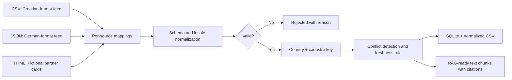

# Multi-Source Public Auction Data Pipeline

**Independent portfolio demonstration** | Python / ETL / EU-localized data parsing / data quality / provenance / RAG-ready exports

This is a runnable, offline proof of work inspired by the engineering challenge of harmonizing public auction listings across countries and source formats. **It is an independent synthetic demonstration, not commissioned by or endorsed by a real auction platform or property-data provider.** All property identifiers, URLs, and listings are fictional.

## Problem being demonstrated

Cross-border auction information arrives in country-specific formats, changing field names, inconsistent monetary/date conventions, and potentially conflicting revisions. Downstream intelligence should never silently collapse these disagreements or lose the origin of a record.



## Run locally (Python 3.10+, no external dependencies)

```bash
PYTHONPATH=src python -m auction_pipeline.cli demo
PYTHONPATH=src python -m unittest discover -s tests -v
```

Windows PowerShell:

```powershell
$env:PYTHONPATH = 'src'
python -m auction_pipeline.cli demo
python -m unittest discover -s tests -v
```

This produces `output/normalized.csv`, `output/rejected.jsonl`, `output/conflicts.jsonl`, `output/auctions.sqlite`, `output/rag_chunks.jsonl` and `output/summary.json`.

## Expected example outcomes

- 7 source rows across three fictional inputs.
- 1 quarantined bad date.
- 1 conflicting cross-source price, recorded with both source names.
- 5 canonical property records, including the newer revision of the conflicted record.
- 5 RAG-ready **unverified synthetic** text snippets, each retaining source information.

## What this demonstrates

| Problem | Implemented response |
| --- | --- |
| Changing source fields | Per-source mapping in `fixtures/sources.json` |
| Localized values | Date and amount normalization, with rejection of malformed values |
| Multiple languages | Preserve language codes and Unicode source titles |
| Duplicate properties | Deterministic key based on country and synthetic cadastral reference |
| Cross-source contradictions | Explicit conflict report and documented newer-observation rule |
| Traceability | Source name, original ID, example URL, observed-at timestamp |
| Analytical usability | Curated SQLite table, CSV export, and sample citation-bearing text chunks |
| Testability | Offline unit tests, including conflicting data and rerun behavior |

## Explicit scope limits

The HTML parser handles a declared sample card format, not arbitrary production websites. No live scraping, PDF OCR, vector database, LLM integration, cloud deployment or actual legal-verification logic is included. Please see [source quality, legal, and production considerations](docs/source-quality-and-legal.md) before treating this as a blueprint for real registries.

## Why I built it this way

For auction intelligence, knowing **where a fact came from** matters as much as storing it. I would rather flag a conflicted price or invalid date for review than silently choose an apparently clean answer that can no longer be traced back to a source.

## Possible fixed-scope engagement

An initial assignment might be to implement one approved live source connector plus normalization, provenance, quality checks, and documented acceptance tests, then expand to more countries after the ingestion contract is stable.

**Author:** Ysmael A. Cailon | [GitHub](https://github.com/ycailon)
